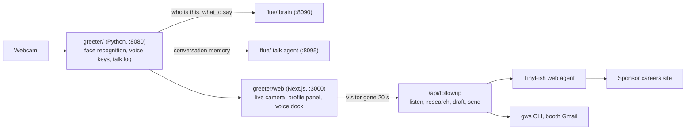

# Touchpoint (Hack Western 13)

Touchpoint is a greeter for a sponsor's booth at a hackathon. A camera recognises who walks up, a voice agent greets them by name and talks with them about what they have actually built, and a screen beside the camera shows their profile and the things the conversation turns to. When a visitor who talked walks away, Touchpoint does the recruiter's follow-up for them: it reads what was said, finds open roles on the sponsor's live careers site that fit, writes a short email and sends it from the booth's Gmail.

Devpost is due Sunday Nov 22 at 9:00 AM ET. The write-up draft is in [docs/devpost-draft.md](docs/devpost-draft.md).

## How it works



1. **Recognise.** `greeter/` finds the main face in view with YuNet, fingerprints it with EdgeFace (OpenCV on the CPU) and looks it up in `greeter/greeter.db` with sqlite-vec. Below the match bar it asks who the person is instead of guessing.
2. **Decide.** The Python greeter asks the Flue brain (`flue/src/brain.ts`, port 8090) whether to greet, check the name first, or stay quiet, and what to say. The model can only answer through a schema-checked `decide` tool, and code checks that the talking point is one of the person's real facts. If the brain is down, a mock agent in `greeter/greeter/agent.py` takes over. With `GEMINI_API_KEY` set, the brain and the talk agent both run on the Gemini API (`gemini-3-flash-preview`).
3. **Talk.** The web page opens an OpenAI Realtime voice session over WebRTC with a short-lived key minted by the Python greeter, already briefed on the person. With `CARTESIA_API_KEY` set, Cartesia (`sonic-3.6`) does the speaking. Every line goes back to the greeter and to the Flue talk agent (`flue/src/talk.ts`, port 8095), which keeps a memory per person.
4. **Show.** As the conversation moves, the voice agent calls a `show` tool, and `/api/talk/ui` writes one screen in OpenUI Lang that streams into React components (Portrait, ProjectMoment, Faces, Path, Spotlight and others). Gemini writes it, in about 1.3 seconds for a full screen; if Gemini errors before any text arrives, OpenAI (`gpt-5.6-luna`) takes over.
5. **Follow up.** When the visitor leaves, the booth follow-up below runs.

## The booth follow-up

The web app starts the follow-up when a visitor who said at least two things has been out of view for 20 seconds. Someone stepping back up cancels it, and unknown guests are skipped. The run is one request to `POST /api/followup`, streamed back with the Vercel AI SDK (`createUIMessageStream` data parts on the server, `useChat` on the client), so each step, the live browser, the roles and the email update in place as they change.

1. **Listen.** Reads that visit's lines from the `talk` table in `greeter/greeter.db` (a gap of 20 minutes ends a visit) plus the person's profile facts, and builds a brief with AI SDK `generateObject` (OpenAI `gpt-4.1-mini`): a one-line summary, interests, what they asked for, and a job search query.
2. **Research.** A TinyFish web agent (`agent.tinyfish.ai` `run-sse`) opens the sponsor's live careers site. By default the greeter first reads what the visitor has built (from the conversation, their profile and their GitHub repos) and picks the Hack Western sponsor whose roles fit them best, from the list in `greeter/web/lib/followup/sponsors.ts` (Scotiabank, Manulife, Shopify, Autodesk, OpenAI, DoorDash, Accenture, Commure, TinyFish, CSE and StarTech). The agent starts on that sponsor's search results for the visitor's query. The agent's live browser is shown in the UI as an iframe, and each step it takes appears as it happens. It returns 2 to 4 real postings with links and a one-line reason each. It is told never to sign in, apply or submit anything except the search box.
   - A backup engine starts at the same time and runs quietly: TinyFish Search and Fetch find and read postings on the sponsor's domain and an OpenAI model picks the ones that fit, with OpenAI web search as a last resort. Only URLs that appeared in real search or fetch results are kept.
   - If the TinyFish agent fails or passes its 150 second cap, the backup's roles are used and the UI shows the switch.
3. **Draft.** AI SDK `streamText` writes a short follow-up email from the brief and the roles, streamed into the email card word by word. It may not invent roles, links or facts.
4. **Send.** The email goes out right away from the booth's Gmail through the gws CLI (Google Workspace CLI) HTML email script. The address comes from the Hack Western Slack members export. Each visitor gets at most one email every 6 hours (tracked in memory by the web server), and the manual **Follow up** button forces a new one.

The UI is `FollowUpView` in [greeter/web/app/live/followup.tsx](greeter/web/app/live/followup.tsx): the four steps, the live TinyFish browser, a ticker of the agent's actions, the backup notice, role cards, the brief, and the email card going from drafting to sent. It appears as a glass sheet over the camera on the main page. It also has its own page:

- `/followup?mock` plays a scripted 25 second run (`&fail=1` shows the backup taking over, `&speed=2` runs it faster).
- `/followup?person=<Slack user id>` runs the real follow-up for one person (`&to=<email>` changes the recipient, `&send=0` saves a draft instead).
- `/?nofollowup` turns the automatic run off on the main page; the button still works.

Measured by the team on Nov 22: starting from the Scotiabank homepage, the TinyFish agent found 4 real postings in about 175 seconds (about $0.37, at $0.016 per step). Starting from the search results page, it found 4 in 120 seconds and 17 steps (about $0.27). The backup finds real postings in 8 to 21 seconds. An end-to-end run delivered a real email.

Code: [greeter/web/app/api/followup/route.ts](greeter/web/app/api/followup/route.ts) and [greeter/web/lib/followup/](greeter/web/lib/followup/) (`types`, `env`, `research`, `tinyfish`, `backup`). The mock stream is [greeter/web/app/api/followup/mock/route.ts](greeter/web/app/api/followup/mock/route.ts), and [greeter/web/scripts/try-research.mts](greeter/web/scripts/try-research.mts) runs the research step alone from the command line.

## "Is this you?" (Auth0 passkeys)

While someone is talking with the greeter, the booth panel shows a QR code for them. They scan it with their own phone, see "Is this you? Tap to get your follow-up", sign in with an Auth0 passkey (Face ID or Touch ID, no password), and tap Yes. The booth card flips to "Confirmed with an Auth0 passkey" and shows the address only masked (`a•••@gmail.com`). The recruiter can sign in on the booth screen the same way.

- `greeter/web/lib/consent.ts` stores each decision with the Auth0 account behind it in `greeter/web/.data/consent.json` (gitignored). `confirmedContact(personId)` returns the email that person confirmed, for the follow-up to use. Today the follow-up still sends to the address in the Slack export.
- Each QR carries a ticket for that one person, signed with `AUTH0_SECRET` and valid for 20 minutes (`lib/ticket.ts`), so only someone standing at the booth can confirm. Once a person is confirmed, a different account can't overwrite it.
- Phones reach the laptop through a cloudflared tunnel. `proxy.ts` limits tunnel traffic to the confirm page, Auth0's `/auth/*` routes and the confirm API; everything else, including the camera and the people data, returns 404.
- With no `AUTH0_*` keys, all of this is off and the booth works as before. Tenant setup is in [greeter/web/README.md](greeter/web/README.md).

## Run it

You need Python 3.11 to 3.13 with [uv](https://docs.astral.sh/uv/), Node 23.6 or newer, and for sending email an authenticated gws (Google Workspace CLI) on the booth laptop. Put keys in `greeter/.env` (gitignored); see the table below.

```sh
# 1. the brain and the conversation agent
cd flue && npm install
npm run brain                    # http://127.0.0.1:8090
npm run talk                     # http://127.0.0.1:8095 (second terminal)

# 2. face recognition and the API, with a webcam
cd greeter
uv run greeter --camera 0 --brain http://127.0.0.1:8090    # http://localhost:8080

# 3. the web app
cd greeter/web && npm install
npm run build && npm start       # http://localhost:3000 (npm run dev while editing)
```

Without a camera, `uv run greeter` serves the API from photos only. `uv run greeter-eval` measures recognition accuracy on held-out photos, `cd flue && npm test` runs the brain's rule tests, and `/followup?mock` shows the follow-up without any keys.

To try the research step alone: `cd greeter/web && node_modules/.bin/jiti scripts/try-research.mts` (add `FOLLOWUP_FORCE_BACKUP=1` to skip the agent).

## Environment

The follow-up reads each variable from the environment first, then from `greeter/web/.env.local`, `greeter/.env` and `flue/.env`.

| Variable | What it does |
| --- | --- |
| `GEMINI_API_KEY` | The Gemini API: the brain, the conversation agent and the screen writer (`gemini-3-flash-preview`). Also goes in `flue/.env` |
| `OPENAI_API_KEY` | Realtime voice, the screen writer's fallback, and the follow-up's brief, email and backup search |
| `CARTESIA_API_KEY` | Cartesia speaks instead of OpenAI's voice (optional) |
| `TINYFISH_API_KEY` | The TinyFish web agent and TinyFish Search and Fetch. Without it the follow-up uses OpenAI web search only |
| `BOOTH_COMPANY` | Pin every follow-up to one sponsor's booth. Unset (the default), each visitor is matched to the sponsor that fits what they build |
| `FOLLOWUP_FROM` | Sign-off for matched follow-ups (default "Touchpoint, the Hack Western 13 greeter") |
| `BOOTH_CAREERS_URL` | The sponsor's careers site (default https://jobs.scotiabank.com/) |
| `BOOTH_SEARCH_URL` | The careers site's search results URL with `{q}` for the query; the agent starts there |
| `BOOTH_RECRUITER` | Who the email is signed by |
| `FOLLOWUP_SEND=0` | Save a Gmail draft instead of sending |
| `FOLLOWUP_TEST_TO` | Send every follow-up to this one address (for testing and demos) |
| `FOLLOWUP_FORCE_BACKUP=1` | Skip the TinyFish agent and use the backup engine |
| `FOLLOWUP_AGENT_SECONDS` | The TinyFish agent's time cap (default 150) |
| `FOLLOWUP_MODEL` | The OpenAI model for the follow-up (default `gpt-4.1-mini`) |
| `GWS_EMAIL_SCRIPT` | Path to the gws HTML email script (default `~/.codex/skills/gws-email/scripts/gws_email.py`) |
| `AUTH0_DOMAIN`, `AUTH0_CLIENT_ID`, `AUTH0_CLIENT_SECRET`, `AUTH0_SECRET` | Turn on the "Is this you?" passkey confirmation. `AUTH0_SECRET` is any random 32 bytes (`openssl rand -hex 32`). Leave `APP_BASE_URL` unset |
| `PUBLIC_URL` | The address the QR code points phones at (optional; the app starts its own cloudflared quick tunnel otherwise) |
| `GREETER_API` | Where the web app finds the Python greeter (default http://127.0.0.1:8080) |
| `GREETER_MODEL` | The brain's model, for example `openai/gpt-4.1-mini` (see [flue/README.md](flue/README.md)) |

## Sponsor tech we used

- **TinyFish:** the web agent that browses the sponsor's careers site with a live view in the UI, plus TinyFish Search and Fetch in the backup engine.
- **Gemini API:** `gemini-3-flash-preview` runs the brain that decides whether and how to greet someone, the conversation agent that remembers each person, and the screen writer.
- **Auth0:** passkey sign-in (Face ID or Touch ID) on the visitor's own phone for "Is this you?", and for the recruiter on the booth screen.
- **GoDaddy Registry:** the landing page in [site/](site/), on a free domain from the MLH GoDaddy Registry challenge.
- **Vercel AI SDK:** `createUIMessageStream` and `useChat` for the streamed follow-up UI, `generateObject` for the brief, `streamText` for the email, and `generateText` with structured output in the backup.
- **OpenAI:** Realtime voice over WebRTC, `gpt-4.1-mini` for the follow-up, and web search as the last fallback.
- **Cartesia:** `sonic-3.6` text to speech for the greeter's voice, streamed a clause at a time.
- **Google Workspace (gws CLI and Gmail):** sends the follow-up from the booth's Gmail.

The rest of the stack: Next.js 16, React 19, Python with OpenCV (YuNet and EdgeFace), SQLite with sqlite-vec, the Flue agent harness, OpenUI Lang and three.js.

## What's in this repo

| Path | What it is |
| --- | --- |
| [greeter/](greeter/) | Face recognition, the camera loop and the API on port 8080, voice session keys, the talk log. Details and accuracy numbers in [greeter/README.md](greeter/README.md) |
| [greeter/web/](greeter/web/) | The Next.js app on port 3000: live camera, profile panel, voice dock, generated screens and the booth follow-up |
| [flue/](flue/) | The brain (port 8090) and the conversation agent (port 8095) on the Flue agent harness. See [flue/README.md](flue/README.md) |
| [hack-western-13-people/](hack-western-13-people/) | The people data: public profiles, photos and sourced facts for attendees |
| [people.db](people.db) and [scripts/](scripts/) | The merged people directory and the scripts that build and export it |
| [site/](site/) | The public landing page and how to put it on the GoDaddy Registry domain |
| [docs/](docs/) | The Devpost draft, the sponsor track strategy, the track list and the booth recognition research |

The Pi, Arduino and QNX notes in `docs/` and `hardware-photos/` are from an earlier hardware idea (SafeStop) that we dropped. The Arduino line in `greeter/greeter/link.py` is still mocked.
