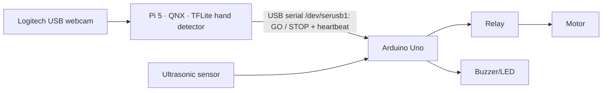

**What an Arduino is and how it works with our QNX Pi 5**

An Arduino is a small board built around a microcontroller, for example the ATmega328P on an Uno. A microcontroller is one chip with a CPU, a little memory (32 KB for code, 2 KB of RAM) and pins that connect to the physical world. It runs no operating system, only your one program, so its timing is very predictable.

### How the code runs
You write C++ in the Arduino IDE. `setup()` runs once when the board powers on. `loop()` then runs forever, thousands of times a second. When you click Upload, your computer compiles the code and a small loader already on the chip (the bootloader) writes it into flash over USB. From then on the program runs every time the board gets power.

### Talking to hardware
- `digitalWrite(pin, HIGH)` sets a pin to 5 V, for an LED or relay. `digitalRead` checks a button.
- `analogRead` turns a voltage into a number from 0 to 1023 (potentiometer, light sensor).
- `analogWrite` switches a pin on and off very fast (PWM) to dim LEDs or set motor speed. Servos use a similar timed pulse.
- `Serial.begin(115200)` lets the board send and receive text over USB.

### Our split of work
The Pi 5 running QNX is the brain: it reads the camera, runs the AI model and decides. The Arduino is the reflexes: it reads fast sensors, drives the motor and relay, and stops the machine by itself if the Pi goes quiet.

**Message format:** the Pi sends `H` (heartbeat) every 50 ms, plus `S` (stop) or `G` (go). The Arduino stops the motor on `S`, when an object is within 10 cm, or when no `H` has arrived for 200 ms.

### QNX notes
- Camera: plug the Logitech webcam into a **blue USB 3 port**. On the Pi 5 it is the generic USB camera, `SENSOR_UNIT_5` in `/etc/config/sensor/sensor_rpi5.conf`. Logitech C920 is officially tested; our 720p model should work the same way but check it first.
- AI module: check `apk list --available | grep -i -E 'tflite|opencv|mediapipe'` on the Pi before writing code. Building TFLite from source needs a Linux host, so avoid it.
- Arduino link: a genuine Uno or Leonardo should show up as `/dev/serusb1` via `devc-serusb` (check with `usb -vvv`). CH340 clones may not. Opening the port resets the board, so wait about 2 s before sending.
- Pi GPIO from Python: `import rpi_gpio as GPIO` (hardware PWM on GPIO 12/18 and 13/19).

### Checklist
- [ ] Pi 5 and webcam borrowed (done). Arduino: ask the hardware desk or bring one.
- [ ] Check which AI packages are available with `apk list`.
- [ ] Confirm the webcam streams as SENSOR_UNIT_5.
- [ ] Confirm `/dev/serusb1` appears when the Arduino is plugged in.
- [ ] Hand detector running at a steady frame rate.
- [ ] Wire relay, motor and ultrasonic sensor.
- [ ] Failure tests: kill the process, pull the camera, pull the USB. The motor must stop every time.
- [ ] Record the demo video Saturday night. Devpost is due Sun 9:00 AM. Return hardware by 5 PM.

Sources: QNX Everywhere docs (Raspberry Pi GPIO/UART, QSTI camera section), gitlab.com/qnx/projects/hardware-component-samples, github.com/qnx-ports/build-files.
